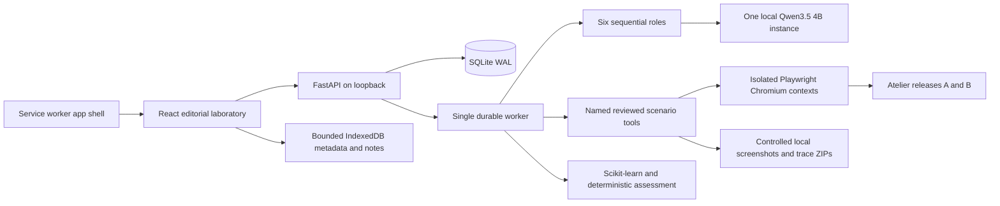

# Architecture

The source of truth is the local backend, not the browser cache. One Uvicorn process owns one durable worker and one sequential model client. This keeps the default deployment appropriate for 16 GB RAM and 6 GB VRAM.



## Repository map

| Path | Responsibility |
| --- | --- |
| `src/App.tsx` | Navigation and ten data-backed laboratory rooms |
| `src/styles.css` | Central palette, font faces, typography, editorial responsive layout |
| `src/offline.ts` | Dexie cache, bounded metadata, idempotent note operation queue |
| `backend/main.py` | Validated API, diagnostics, graph, reports, static serving |
| `backend/store.py` | SQLAlchemy engine, versioned schema, records and orders |
| `backend/runner.py` | Persistent job lifecycle, browser allowlist, evidence capture |
| `backend/intelligence.py` | Pydantic decisions and bounded sequential Ollama calls |
| `backend/ml.py` | Grouped training/evaluation, anomaly detection, ranking, fallback |
| `backend/commerce.py` | Session/cart/order APIs for two fixture releases |
| `backend/templates/commerce.html` | Functional fictional shop UI |
| `demo/defects.json` | Evaluation-only injected defect manifest |
| `tests/` | API/browser/database/ML/offline/recovery checks |
| `e2e/` | Frontend browser integration |

## Persistence and migrations

Schema version 1 is explicitly registered in `schema_migrations`. Startup creates the migration registry and applies unapplied numbered SQL files from `backend/migrations/` through SQLAlchemy. The initial migration creates `records`, `orders` and their indexes; repeated startup leaves the schema intact. Future schema changes must be new explicit migrations. Migration files use simple SQL statements rather than stored programs containing embedded semicolons.

Records use a kind, stable identifier, timestamp and JSON body. Experiment bodies retain objective, status, environment, events, agents, assertion results and risk limitations. Orders are relational rows with a unique `(release, session, checkout_key)` constraint. Baseline uses the caller’s stable checkout key; candidate deliberately replaces it to reproduce the defect.

Job states are `queued → running → completed | failed | cancelled`. An uncleanly interrupted `running` job becomes `interrupted` at startup with retained evidence. It does not silently resubmit checkout. Untouched queued jobs resume normally. This is a single-consumer queue, not a distributed lease protocol; run exactly one backend process.

Each scenario creates a fresh browser context and guest session. Results reference actual order rows; no cumulative global count is used. Artifact paths are generated by the worker and validated at download. Evidence IDs are stable per experiment, release and scenario.

## Agent state and tools

Investigator, Explorer, Scenario Architect, Experiment Operator, Evidence Analyst and Release Analyst call the same Ollama model sequentially. Explorer receives bounded visible text collected by a reviewed browser tool. The model only returns a schema with summary, scenario enum choices, uncertainties and a recommendation. Untrusted visible text is JSON data in a user message and never has system authority.

Tools have fixed implementations: ordinary checkout, immediate repeated checkout, discount, keyboard focus and delayed fixture feedback. Agents cannot supply JavaScript, shell commands, selectors, Python, arbitrary URLs or SQL. The model’s plan changes which optional scenarios run. The signature experiment always includes ordinary and repeated checkout for both releases.

Inference has two bounded attempts, a 100-second request timeout, 4096 context tokens and bounded output. Thinking is disabled for the structured decision path. A failed/invalid inference is recorded as unavailable. Deterministic execution remains labeled; it never masquerades as model reasoning. The full experiment has a 900-second deadline; each browser run has a 50-second deadline; only one browser executes at once.

## Offline layers

Vite PWA precaches same-origin application resources, including the exact local fonts. API routes and demo pages are excluded from the navigation fallback. IndexedDB stores the last 20 experiment documents and selected metadata; binary artifacts are never automatically downloaded for caching.

Safe note operations have UUID idempotency keys and expected revisions. The backend atomically saves a note and operation result. Duplicate submission returns the prior result. A revision mismatch returns HTTP 409; the client keeps both drafts for explicit review. Foreground reconnect polling replaces unavailable Background Sync functionality. Experiment starts and cancellation are not automatically queued as offline destructive retries.

Backend liveness is measured through actual API requests. Internet availability uses `navigator.onLine` and is described as a browser signal, not a proof of public internet access. Ollama has its own health/installed-model probe. These states are intentionally independent.

## ML contract

Training CSV columns:

```text
release_family,changed_modules,changed_dependencies,prior_failure_rate,
instability,coverage,prior_regressions,prior_performance_delta,regressed
```

Each feature must be known **before** the release outcome. Current-release failure counts must never be relabeled as prior history. Related releases share `release_family`; the holdout splits whole families. Feature extraction from arbitrary Git repositories is not implemented; input provenance must be validated before using real histories.

Minimum dataset and class checks fail closed. Synthetic training uses a separate model filename. Feature importance describes the fitted classifier, not causal effects. The production UI currently reports the deterministic assertion fallback, without a probability or confidence. Isolation Forest is fit only on prior experiment rows; it can flag unusual patterns but cannot establish defects. Ranking uses a transparent rule instead of pretending a learned ranker has enough data.

## Performance budget

The local model was observed using approximately 3.14 GB VRAM at 4096 context tokens. Browser concurrency is one. Trees train with `n_jobs=1`. No Docker, Redis, cloud authentication or cloud worker is needed. Graph/charts are split into separate frontend bundles and precached for offline use.
